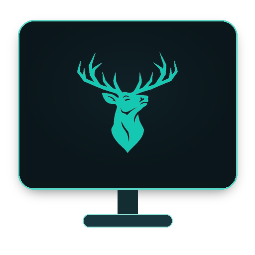

# Ramord Cast

<p align="center">
  
  <br>
  <b>Wireless Screen Mirroring & Independent Virtual Second Display for Linux</b>
  <br>
  <i>Linux için Kablosuz Ekran Yansıtma ve Bağımsız Sanal İkinci Ekran Aracı</i>
</p>

<p align="center">
  <a href="#features">Features</a> •
  <a href="#supported-protocols">Protocols</a> •
  <a href="#installation">Installation</a> •
  <a href="#how-to-use">How to Use</a> •
  <a href="#türkçe-açıklama">Türkçe Açıklama</a> •
  <a href="#license">License</a> •
  <a href="#contact--support">Contact</a>
</p>

---

## Features

**Ramord Cast** is an open-source wireless display utility engineered for Linux desktops, providing low-latency screen casting and independent virtual second displays to Smart TVs and external monitors.

### Highlights

- **Low Latency:** Hardware-accelerated 60 FPS streaming with sub-25ms response time.
- **Independent 2nd Display:** Extend your workspace without cables using Samsung Workspace / RDP protocol.
- **Directional Screen Layout:** Place the virtual monitor to the **Right**, **Left**, **Above**, or **Below** your primary display.
- **Hardware Mouse & Keyboard Passthrough:** Control your Linux workstation directly via your Smart TV remote, mouse, or keyboard.
- **Zero-Config Discovery:** Automatic mDNS / SSDP network discovery for AirPlay 2, Samsung TV, and Google Cast targets.
- **6-Language Native Support:** English, Turkish, German, Spanish, French, and Italian UI localization.

---

## Supported Protocols

1. **Apple AirPlay 2 (Recommended & Default):**
   - Zero-PIN connection with saved pairing credentials.
   - Hardware-accelerated 60 FPS video streaming with low latency.
   - Color accuracy and dynamic bitrate management.

2. **Samsung Workspace (PC on TV / Independent 2nd Display):**
   - Independent Full HD (`1920x1080`) virtual second screen streamed over local network RDP.
   - Directional placement: Configure your 2nd display to the **Right**, **Left**, **Above**, or **Below** your primary monitor.
   - Remote mouse and keyboard control on Samsung Smart TV or Monitor without physical cables.
   - Live credential display (IP, Username, Password, Port: `3389`).

3. **Google Cast / Chromecast (Fallback Protocol):**
   - Standard Google Cast protocol for Chromecast devices, Android TVs, and compatible displays.

---

## Installation

### Automated Setup

Run the installation script to set up all required dependencies, system commands, and application launchers:

```bash
git clone https://github.com/ramordcommunity/ramordcast.git
cd ramordcast
bash install.sh
```

The installer configures:
- Binary executable in `~/.local/bin/ramordcast`
- Application desktop launcher in `~/.local/share/applications/com.ramord.cast.desktop`
- Scalable application icon in `~/.local/share/icons/hicolor/scalable/apps/ramordcast.png`

### Running the Application

You can launch Ramord Cast in either way:
- **Terminal:** Type `ramordcast` or run `python3 main.py` inside the project directory.
- **Desktop Launcher:** Open your application menu (GNOME, KDE Plasma, etc.) and launch **Ramord Cast**.

### Manual Dependency Installation

If you prefer installing dependencies manually using your distribution package manager:

- **Arch Linux / CachyOS / Manjaro:**
  ```bash
  sudo pacman -S --needed python python-gobject python-requests gtk4 libadwaita pipewire krdp
  ```
- **Ubuntu / Debian / Linux Mint:**
  ```bash
  sudo apt update
  sudo apt install -y python3 python3-gi python3-requests gir1.2-gtk-4.0 gir1.2-adw-1 pipewire
  ```
- **Fedora:**
  ```bash
  sudo dnf install -y python3 python3-gobject python3-requests gtk4 libadwaita pipewire
  ```

---

## How to Use

### Option A: Apple AirPlay 2 (Screen Mirroring)
1. Ensure your PC and TV are connected to the same Wi-Fi or local network.
2. Select **Apple AirPlay 2**.
3. Choose your TV from the scanned list and click **Start Cast**.

### Option B: Samsung Workspace (Independent 2nd Screen)
1. Select **Samsung Workspace (PC on TV / 2nd Display)**.
2. Select **Extend (Independent 2nd Display)** and configure its position (**Right**, **Left**, **Above**, or **Below**).
3. Click **Start Cast**.
4. On your Samsung TV / Monitor: Open **Menu > Connected Devices > Workspace > Windows PC**.
5. Enter the **IP Address**, **Username**, and **Password** displayed on the Ramord Cast screen and connect.

---

## Türkçe Açıklama

**Ramord Cast**, Linux masaüstünüzü Smart TV'lere, monitörlere veya harici ekranlara düşük gecikmeyle kablosuz yansıtmanızı ve bağımsız sanal ikinci ekran oluşturmanızı sağlayan açık kaynaklı bir uygulamadır.

### Desteklenen Protokoller ve Özellikler

1. **Apple AirPlay 2 (Önerilen ve Varsayılan):**
   - Kayıtlı kimlik bilgileriyle PIN sormadan otomatik bağlantı.
   - Donanım hızlandırmalı 60 FPS yayın ve 25ms altı düşük gecikme süresi.
   - Renk ve dinamik bit hızı doğruluğu.

2. **Samsung Workspace (TV'de PC / Bağımsız 2. Sanal Ekran):**
   - Yerel ağ üzerinden RDP protokolüyle oluşturulan bağımsız Full HD (`1920x1080`) sanal ikinci ekran.
   - Yön seçimi: İkinci ekranınızı ana monitörünüzün **Sağına**, **Soluna**, **Üstüne** veya **Altına** yerleştirme imkanı.
   - Kabloya ihtiyaç duymadan Samsung Smart TV veya monitörünüzün kumanda, fare ve klavyesiyle doğrudan kontrol.
   - Gerçek zamanlı bağlantı bilgileri gösterimi (IP Adresi, Kullanıcı Adı, Şifre, Port: `3389`).

3. **Google Cast / Chromecast (Yedek Protokol):**
   - Chromecast ve Google Cast destekli TV cihazları için standart yansıtma.

### Kurulum ve Çalıştırma

```bash
git clone https://github.com/ramordcommunity/ramordcast.git
cd ramordcast
bash install.sh
```

Terminalden `ramordcast` yazarak veya masaüstü uygulama menünüzden doğrudan başlatabilirsiniz.

---

## Developer Note & Purpose

The initial inspiration behind developing Ramord Cast was to display a wireless dual-screen setup side-by-side on a single Samsung Smart Monitor using **Samsung Multi View** (Source 1: Active Game/PC on HDMI, Source 2: Wireless Linux Display). 

Due to Samsung Tizen OS hardware scaler limitations and proprietary Wi-Fi Display protocol boundaries, achieving seamless automated Multi View pairing proved challenging on certain firmware versions.

The project is fully open-sourced for developers, reverse engineers, and the open-source community to take this research forward.

For protocol breakdown and technical logs, see [Research Notes & Development Log](RESEARCH_NOTES.md).

---

## License

Distributed under the **GNU General Public License v3.0 (GPL-3.0)**. See [LICENSE](LICENSE) for details.

---

## Contact & Support

- **Official Email:** `ramordhelp@gmail.com`
- **GitHub Organization:** [Ramord Community](https://github.com/ramordcommunity)
